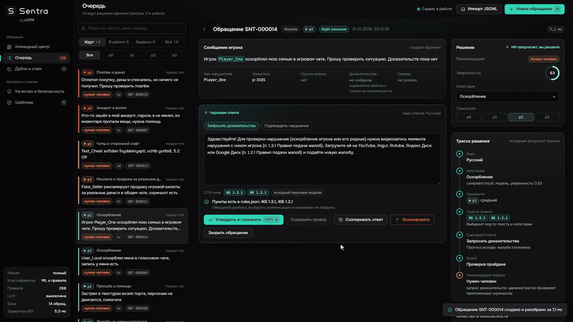
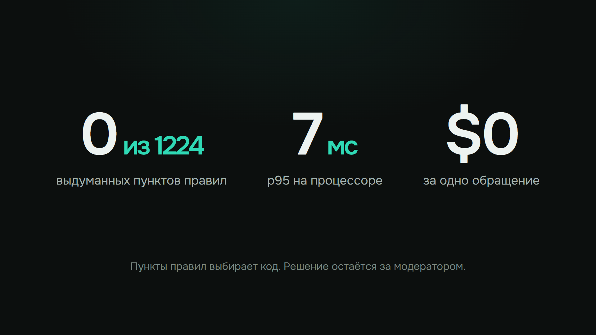
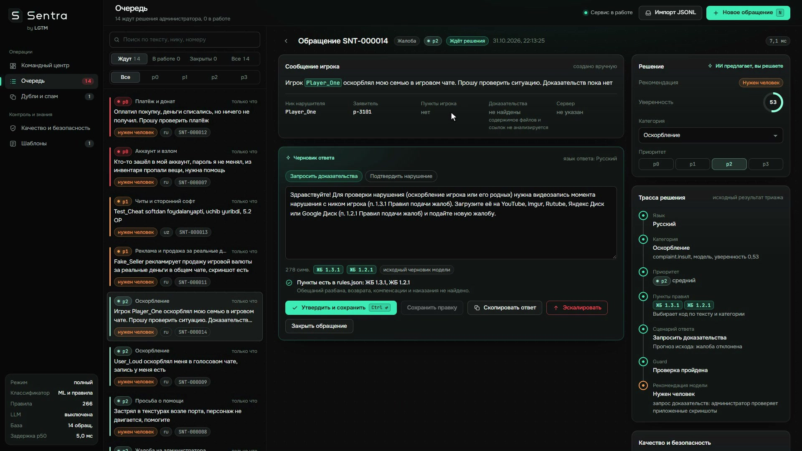
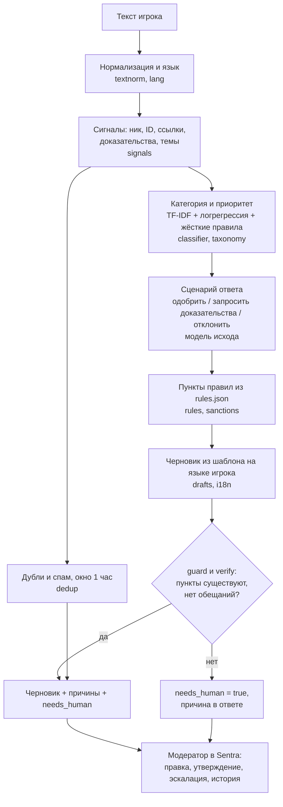

<div align="center">

<picture>
  <source media="(prefers-color-scheme: light)" srcset="admin_ui/assets/sentra-lockup-light.svg">
  
</picture>

**Помощник модератора Grand Mobile. Разбирает обращения игроков, цитирует только настоящие пункты правил, а решение оставляет человеку.**

Кейс 03 «Support Copilot» · Decentrathon 6.0 · команда LGTM


scikit-learn · FastAPI · SQLite · только CPU · без внешних API

<br>

<a href="https://youtu.be/Epsk-K0D0dA"></a>

<br><br>

<a href="https://youtu.be/Epsk-K0D0dA"></a>

<sub>Фрагменты работы приложения (25 секунд). Нажмите, чтобы открыть полный ролик со звуком.</sub>

</div>



<p align="center">
  <a href="#принцип-работы">Принцип работы</a>
  &nbsp;·&nbsp; <a href="#запуск">Запуск</a>
  &nbsp;·&nbsp; <a href="REPORT.md">Отчёт</a>
</p>

## О проекте

Игрок пишет жалобу или репорт. Sentra за несколько миллисекунд определяет язык, категорию и приоритет, достаёт факты (ник нарушителя, наличие доказательств), замечает дубли и готовит черновик ответа на языке игрока со ссылками на пункты правил. Дальше работает модератор: правит текст, утверждает ответ, эскалирует или закрывает обращение. Всё записывается в историю.

Главная идея: **пункты правил выбирает код, а не модель.** Сервис цитирует только пункты из `rules.json`. Отдельный модуль на выходе не пропускает обещания разбана, возврата или наказания без подтверждения администратора.

| | |
|---|---|
| **Разбор** | Язык (русский, казахский, узбекский, английский, испанский, португальский), категория, приоритет, факты, дубли и спам |
| **Правила** | Цитируются только существующие пункты, наказание берётся из текста пункта |
| **Проверка текста** | Блокирует выдуманные пункты и обещания, предупреждает об утверждениях вроде «уже забанен» |
| **Человек** | Около 9 обращений из 10 помечены «нужен человек». Игроку ничего не отправляется без утверждения |
| **Рабочее место** | Командный центр, очередь, правка и утверждение, эскалация, история решений, SQLite |

## Демо

<p align="center"><a href="https://youtu.be/Epsk-K0D0dA"></a></p>

<p align="center"><a href="https://youtu.be/Epsk-K0D0dA"></a></p>

Ролик записан на настоящем приложении: скрипт нажимает кнопки и вводит текст в браузере, результат в кадре не подставлен. Показ ведёт команда LGTM. Файл лежит и в репозитории: [docs/demo/sentra-demo-ru.mp4](docs/demo/sentra-demo-ru.mp4) (1080p, 47 МБ), его можно скачать.

| Время | Что происходит |
|---|---|
| 0:10 | Командный центр, состояние сервиса |
| 0:26 | Часть 1. Разбор обращения: язык, категория, приоритет, факты, черновик |
| 0:59 | Часть 2. Инъекция в тексте игрока и проверка текста администратора |
| 2:03 | Часть 3. Обращение на казахском |
| 2:31 | Часть 4. Платёж, повтор обращения, эскалация |
| 3:20 | Часть 5. Рабочее место модератора: правка, утверждение, закрытие |
| 4:10 | Слайды: идея, стек, результаты, границы версии |

* Обращения в кадре придуманы для записи. Данные кейса в видео не попали, в репозиторий они не входят.
* Голос синтезирован (ElevenLabs), текст написан командой: [demo_video/DEMO_VOICEOVER_V4.md](demo_video/DEMO_VOICEOVER_V4.md). Музыка: «Lo-Fi Chill», zephiramusic.
* В кадре три цитаты правил из выдачи Grand Mobile (`rules.json`).
* Цифры в командном центре посчитаны по демо-базе из 17 обращений и не являются метрикой качества. Метрики качества ниже.
* Скрипты записи и монтажа: [demo_video/](demo_video/).

## Принцип работы

Сервис разделяет три роли, и у каждой своя зона ответственности.

| Кто | Что делает | Чего не делает |
|---|---|---|
| **Код** | Нормализует текст, определяет язык, достаёт факты, выбирает пункты из `rules.json`, собирает черновик из шаблона, проверяет результат | Не угадывает номера пунктов и сроки наказаний |
| **Модель** | Предсказывает категорию, приоритет и вероятный исход жалобы (scikit-learn, обучена на данных кейса, работает на CPU) | Не пишет текст ответа и не выбирает пункты |
| **Человек** | Правит, утверждает, эскалирует и закрывает обращение | Не ищет пункт вручную по 11 разделам правил |

### Путь одного обращения



1. **Нормализация.** Кириллические суррогаты cp1251 (`ќ`, `ѕ`) приводятся к казахским буквам, но только для казахского сервера или при однозначных символах. Украинский и транслит не путаются с казахским и узбекским.
2. **Язык.** По алфавиту и словарям: русский, казахский, узбекский, английский, испанский, португальский.
3. **Сигналы.** Ник и ID нарушителя, ссылки на видео, вложения, упомянутые пункты, фраза «доказательств нет». Это признаки, а не решения.
4. **Категория и приоритет.** Модель на 118 тыс. обращений плюс жёсткие правила для платежей, аккаунта, обжалований и пустого текста. Приоритет считается по критериям `taxonomy.json`.
5. **Сценарий.** Отдельная модель, обученная на вердиктах администраторов, предлагает исход жалобы. Для оскорблений без доказательств ответ просит видеозапись, а не подтверждает нарушение.
6. **Пункты правил (RAG без генерации).** Берётся пункт, названный игроком, если он согласуется с категорией. Иначе пункт категории. Для категории «другое» ищет BM25 по тексту правил с порогом. Размер наказания читается из текста пункта.
7. **Черновик.** Шаблон на языке игрока, собранный по реальным ответам админов. Необязательная LLM может переписать только общий шаблон, и её текст проходит те же проверки (по умолчанию выключена).
8. **Проверка.** `guard` отбрасывает несуществующие пункты и обещания разбана, возврата, компенсации. `POST /verify` проверяет текст, который администратор правит вручную: блокирует выдуманные пункты и обещания, предупреждает об утверждениях вроде «уже забанен».
9. **Решение человеку.** Платежи, аккаунты, жалобы на админов, обжалования, угрозы вне игры, любое наказание другому игроку, низкая уверенность и срабатывание `guard` всегда идут к человеку (`needs_human`). Повтор обращения никогда не закрывается автоматически.

### Что гарантируется и чем проверяется

| Свойство | Как обеспечено | Проверка |
|---|---|---|
| Нет выдуманных пунктов | Номера берёт код из `rules.json`, `guard` удаляет несуществующие | 0 из 1224 цитат на валидации, тесты `tests/` |
| Нет обещаний | Шаблоны без обещаний, `guard` и `verify` ищут формулировки на шести языках | `make eval-drafts`, `make eval-drafts-real` |
| Ответ на языке игрока | Язык определяется до выбора шаблона | 0,983 совпадений с языком ответа админов |
| Устойчивость к инъекции | Текст игрока не попадает в выбор пункта и шаблона как инструкция, подозрительные тексты помечаются | Часть 2 демо, самопроверка `GET /quality/selfcheck`, тесты |
| Скорость и цена | CPU, без внешних API | p95 около 7 мс, $0 за обращение (`make bench`) |

Что код не делает: не отправляет ничего игроку (ответ сохраняется в Sentra, отправку выполняет игровая система), не просматривает видео и скриншоты, не принимает решение о наказании.

### Почему не «LLM на всё»

Выдуманный номер пункта обнуляет тикет, лимит стоимости $0,002 на обращение, p95 до 5 секунд. Локальная Qwen3.5-4B проверена и не включена: p95 14,7 с. Поэтому текст собирают шаблоны, а модели решают только классификацию. Подробности: [docs/LLM_FALLBACK.md](docs/LLM_FALLBACK.md), [docs/audit/FINAL_QUALITY.md](docs/audit/FINAL_QUALITY.md).

## Результаты на валидации (1000 обращений)

| Метрика | Значение |
|---|---|
| Категория, accuracy / macro-F1 (все 1000 обращений valid, своя разметка) | 0,875 / 0,764 |
| Категория на 627 новых текстах (без 373 повторов из train), accuracy / macro-F1 | **0,818 / 0,722** |
| Приоритет, macro-F1 (все 1000 / 627 новых текстов) | 0,880 / 0,827 |
| Сценарий черновика совпадает с реальным решением админа (518 жалоб с распознанным вердиктом) | 0,645 |
| Цитаты несуществующих пунктов | **0 из 1224** |
| Доля черновиков со ссылкой на пункт правил | 0,803 |
| Язык черновика совпадает с языком реального ответа админа | 0,983 (`ru`: 856, `uz`: 131, `kk`: 9, `en`: 4) |
| Доля «нужен человек»: всего / жалобы / репорты | 0,917 / 0,958 / 0,732 |
| Латентность p50 / p95 (без LLM), вызов в процессе | 2,9 мс / 7,2 мс |
| Латентность p50 / p95 по HTTP (`make bench`, 1000 вызовов) | 4,5 мс / 7,2 мс |
| Стоимость | $0 (локально, CPU) |

Метрики пересчитаны 31.10.2026 на выданных данных (`make train`, `make gold`, `make eval`;
см. [REPORT.md](REPORT.md), разделы 6, 6а, 6б и 6в). Категория и приоритет на валидации **не изменились** (0,875 / 0,764 и 0,880), число цитат — **1224** (0 несуществующих). Воспроизведение: положите выдачу кейса
в `data/` и выполните эти же команды.

Как считались метрики и где они слабые, написано в [REPORT.md](REPORT.md). Коротко: категорий и
приоритетов в выданной валидации нет, поэтому dev-разметку мы сделали сами по
`taxonomy.json` (это черновик организаторов). Цифры по категории ориентировочные.

Оговорка о повторах: 373 из 1000 тикетов valid дословно или почти дословно есть в train (короткие репорты «помогите», «дм», «читер»). На остальных 627 («чистых») новых текстах категория
даёт accuracy **0,818** и macro-F1 **0,722**, приоритет macro-F1 **0,827**. Разбор по языкам и классам,
проверка локальной Qwen3.5-4B (не включена: p95 14,7 с) и остальные итоги проверки: [docs/audit/FINAL_QUALITY.md](docs/audit/FINAL_QUALITY.md).

### Почему детерминированные шаблоны и почему `needs_human = 91,7 %`

* **Точность правил против свободной генерации (30 % оценки Response Quality).** По условиям кейса выдуманный номер пункта обнуляет весь тикет. Поэтому пункты правил выбирает код по `rules.json`, а черновик строится по проверенным шаблонам шести языков с подстановкой точного названия нарушения (например, оскорбление родных по п. 2.1 на русском, казахском и узбекском) и диапазона санкции из текста правила.
* **Какую нагрузку снимает Sentra при 91,7 % `needs_human`.** В валидации 81,7 % потока составляют жалобы на игроков со скриншотами и видео, которые текстовый сервис не просматривает (по жалобам `needs_human = 95,8 %`). При этом:
  1. На репортах (`kind = report`) **26,8 % обращений закрываются без участия человека** (вопросы по механике из базы знаний, маршруты GPS-навигатора, кнопка эвакуатора при застревании транспорта, оффтоп).
  2. На остальных 91,7 % обращений Sentra снимает **рутину подготовки**, а не заменяет решение человека: за ~3 мс определяет язык (включая казахский в cp1251 и узбекский), категорию, приоритет, связывает дубли (сохраняя содержательный черновик по категории), подбирает точный пункт из 266 правил с санкцией и готовит ответ на языке игрока. Модератору остаётся проверить видео и нажать одну кнопку вместо ручного поиска по 11 разделам правил и перевода.

### Качество черновиков (аудит 31.10.2026)

Критерий весит 30 %, поэтому черновики проверены отдельно: [docs/audit/DRAFT_QUALITY.md](docs/audit/DRAFT_QUALITY.md). Находки на 60 слепых
парах, 1000 тикетах valid, 72 синтетических пробах и независимой выборке из 8000 тикетов train:

* обжалование (16 % тикетов) объявляло итог «наказание выдано верно, жалоба закрыта», хотя сервис наказание не проверял (в 10 из 1000 админ его снял);
  теперь черновик нейтральный, отказ остаётся вариантом для администратора;
* отрицания («я не оскорблял», «это не читер») читались как нарушение; «передано администратору» стояло в 4 % ответов, хотя сервис ничего не передаёт;
* при явном отрицании доказательств («доказательств пока нет», «дәлел әлі жоқ», «hozircha dalil yo'q») для жалобы на оскорбление выбирается сценарий запроса доказательств (`need_evidence`), а не подтверждение нарушения;
* дубли сохраняют содержательный черновик по категории (например, по платежу или оскорблению), а шаблон отклонения дубля (`ЖБ 1.2.9`) предлагается как альтернатива;
* `POST /verify` выдаёт предупреждение, если в тексте ответа утверждается о уже вынесенном наказании («игрок уже забанен», «бұғатталды», «jazolandi»), не блокируя модератора, который действительно применил санкцию;
* запрос видео называл нарушение только в 23 % ответов и ни разу на узбекском; теперь в 72 % (ru 66 %, uz 84 %, а также kk при жалобах на оскорбление);
* срок «30 мин» принимался за ID игрока, репорты «помогите, меня бьют» получали «спросите в Discord».

Итог: 0 обещаний, 0 несуществующих цитат (из 1224), 0 изменений категории и приоритета на валидации, скорость прежняя, **652 теста** проходят (в том числе сквозные в браузере). Финальная полировка:
[docs/audit/FINAL_POLISH.md](docs/audit/FINAL_POLISH.md). Пять минут для жюри:
[docs/DEMO_SCRIPT.md](docs/DEMO_SCRIPT.md), экраны: `docs/audit/screens/`.

## Запуск

Данные кейса в репозитории не хранятся (условия кейса). Положите выдачу организаторов в `data/`:

```
data/tickets_train.jsonl.gz  data/tickets_valid.jsonl  data/rules.json  data/taxonomy.json
```

```bash
make install                 # зависимости: fastapi, scikit-learn, httpx и др.
make train                   # обучение двух моделей на train, около 3 минут на 2 CPU
make predict IN=tickets.jsonl OUT=pred.jsonl
make serve                   # HTTP на :8000, интерфейс Sentra на http://localhost:8000/
make data-status             # что из данных кейса и моделей на месте, а чего не хватает
make test                    # 534 теста без браузера: с data/ и models/ проходят все, без них часть пропускается
make e2e                     # 21 сквозной тест в настоящем браузере (pip install -r requirements-dev.txt, нужен Edge или Chrome); всего 652 теста в `pytest tests`
make bench                   # замер p50/p95 и стоимости по HTTP -> reports/bench_local.json
make gold && make eval       # dev-разметка valid и метрики -> reports/metrics.json
make eval-drafts             # качество черновиков: инварианты на синтетике (язык, пункты, обещания, эскалации)
make eval-drafts-real        # то же на data/tickets_valid.jsonl + выборка для ручной проверки в reports/private/
```

Нет данных кейса, но хочется посмотреть интерфейс: `make serve-fixture` (или `python scripts/serve.py --fixture`). Это
явный режим на **тестовых правилах** из `tests/fixtures`: интерфейс постоянно предупреждает, что номера пунктов не относятся
к Grand Mobile, и никаких обращений сам не создаёт. На Windows `make` обычно нет, тогда те же команды запускаются как
`python scripts/serve.py`, `python scripts/check_data.py`, `python -m pytest tests`.

Python 3.10+. GPU не нужен.

**Что нужно для запуска.** Обязателен `data/rules.json`. Без него сервис стартует, показывает в интерфейсе и в `GET /health`
точную причину, а `POST /triage` отвечает 503: результаты не подменяются. Без `models/` сервис работает на правилах,
`/health` отдаёт `mode: rules_only`, интерфейс пишет «режим: только правила», и качество классификации ниже: модели обучает
`make train` на `data/tickets_train.jsonl.gz`. Обученные модели содержат словарь из обращений игроков, поэтому в
репозиторий не кладутся. Если у проверяющего нет train, модели можно передать отдельным закрытым архивом с согласия
организаторов.

### Пример запроса

```bash
curl -s localhost:8000/triage -H 'Content-Type: application/json' -d '{
  "kind": "complaint",
  "messages": [{"role": "player", "text": "Arman_Petrov оскорблял меня и мою семью в чате, скрины есть, 2.1 ОП", "attachments": 2}]
}'
```

```json
{
  "lang": "ru",
  "category": "complaint.insult",
  "priority": "p2",
  "is_spam_or_duplicate": false,
  "extracted": {"nickname": "Arman_Petrov", "rule_refs": ["2.1"], "has_evidence": true, "server": null},
  "draft_reply": {
    "lang": "ru",
    "text": "Здравствуйте! По приложенным материалам видно нарушение п. 2.1 Общих правил (оскорбление игрока или его родных), нарушитель Arman_Petrov. Наказание по правилам: блокировка персонажа от 3 до 10 дней. Срок назначит администратор.",
    "cited": ["2.1"]
  },
  "needs_human": true,
  "confidence": 0.52,
  "reasons": ["черновик предлагает наказание: решение подтверждает администратор"]
}
```

Необязательные поля запроса из выгрузки (`ticket_id`, `created_at`, `region`, `server_lang`,
`reporter_hash`, `reported_nick`, `rule_refs_raw`, `images_count`) улучшают язык и дедупликацию.
`?debug=true` добавляет служебное поле `_meta` (сценарий, прогноз вердикта, альтернативные черновики).

## Как это устроено

```
текст игрока
  -> нормализация cp1251 (ќ->қ, ѕ->ң, ...) только для kz-сервера или при однозначных суррогатах
  -> язык (алфавит + словари; укр. и транслит не путаются с kk и uz)
  -> сигналы: темы, пункты правил, ID нарушителя, ник, доказательства
  -> категория: TF-IDF + логрегрессия, обученная на 118 тыс. тикетов train
       + жёсткие правила (платёж, аккаунт, обжалование, пустой текст)
  -> приоритет по критериям taxonomy.json
  -> сценарий: модель исхода жалобы (approved / need_evidence / reject, обучена на вердиктах админов)
  -> RAG по правилам: явный пункт игрока, если он согласуется с категорией;
       иначе пункт категории; для «другого» поиск BM25 по тексту правил с порогом
  -> черновик из шаблона на языке игрока, наказание берётся из текста пункта
  -> (опционально) LLM пишет ответ там, где шаблон общий; код проверяет его; фильтр стиля чистит любой ответ
  -> guard: только существующие пункты, нет обещаний -> needs_human
```

Почему не «LLM на всё»: оценка обнуляет тикет за выдуманный пункт, лимит $0,002 и p95 до 5 с.
Шаблоны собраны по реальным ответам админов (русские и узбекские шаблоны есть в train),
поэтому черновики звучат как ответы поддержки, а не как чат-бот. Правила при этом не
придумываются и сроки наказаний не берутся с потолка.

### Когда нужен человек

Всегда: платежи, аккаунт и взлом, жалобы на администратора и обжалования, угрозы вне игры (p0),
любой черновик с наказанием другому игроку, низкая уверенность классификатора,
срабатывание guard. Автоответ разрешён для очевидных случаев: не жалоба (ЖБ 1.1.2), нет описания
(ЖБ 1.2.3), оскорбления в тексте жалобы (ЖБ 1.2.7), дубль, оффтоп в репорт, эвакуатор для
застрявшей машины, просьбы о телепорте и валюте (п. 3.1).

### Дубли и спам

Окно в 1 час: тот же заявитель и тот же нарушитель, либо тот же заявитель с почти тем же текстом (4-граммы, Жаккар).
Спам определяется по повторам слов и бессвязным строкам. `make predict` обрабатывает тикеты по `created_at`.
Совпадение возвращается структурой (`_meta.dedup`): с каким обращением, совпали ли заявитель и нарушитель, измеренное
сходство текста, интервал. В Sentra эти связи хранятся в базе и восстанавливаются в память при перезапуске. Повтор никогда
не закрывается автоматически: он остаётся в очереди и требует решения администратора.

### Sentra by LGTM: рабочее место модератора

`make serve` → `http://localhost:8000/`. Пять экранов: командный центр, очередь с рабочим местом, дубли и спам, качество
и безопасность, шаблоны. Бренд, палитра, логотип: [docs/brand/BRAND.md](docs/brand/BRAND.md). Матрица «что на экране
откуда берётся и что сохраняется»: [docs/audit/FUNCTIONALITY_MATRIX.md](docs/audit/FUNCTIONALITY_MATRIX.md).

**Жизненный цикл обращения.** Форма (текст игрока, сервер, язык сервера, заявитель, ник и ID нарушителя, число файлов,
ссылки) или импорт JSONL → настоящий `Copilot.triage` → запись в SQLite (`var/sentra.db`, переменная `COPILOT_DB`) →
очередь → открытие дела → решение администратора. У обращения стабильный номер `SNT-000123`, время, статус и журнал событий.
Повторное нажатие кнопки не создаёт второе обращение (заголовок `Idempotency-Key`) и не применяет решение дважды
(проверка ревизии `expected_rev`).

**Что хранится.** Исходный результат триажа не меняется никогда. Поправки администратора лежат отдельно: решения
(`decisions`), версии текста ответа (`draft_revisions`, версия 0 это исходный черновик модели), связи дублей, журнал
(`audit_events`, только добавление), решения по шаблонам. Схема версионируется (`PRAGMA user_version`), миграции применяются
при старте. Секреты в базу не пишутся: ключи LLM читаются только из окружения, а пароли, токены и номера карт в тексте игрока
маскируются до записи и до разбора.

**Действия.** «Утвердить и сохранить» (Ctrl+Enter), «Сохранить правку», «Скопировать ответ», «Эскалировать» (причина
обязательна), «Закрыть обращение» (причина обязательна), «Вернуть в работу». **Отправки игроку нет**: канала доставки в
Grand Mobile Sentra не имеет, поэтому утверждённый ответ только сохраняется, а интерфейс прямо пишет, что его нужно отправить
вручную. Любой сохраняемый текст сервер проверяет заново по `rules.json`: номер пункта в тексте обязан существовать, обещание
разбана, возврата, компенсации или наказания блокирует сохранение. Категорию и приоритет админ может поправить; поправка
сохраняется вместе с решением и не затирает ответ модели.

**Честные режимы.** Индикатор в шапке различает «Сервис в работе», «Режим: только правила» и «Триаж недоступен». Тестовые
правила, отсутствие моделей и включённая внешняя LLM показаны баннером. Экран «Качество и безопасность» перечисляет недостающие
файлы кейса и делит показатели на живые (из базы), живую самопроверку (13 проб через настоящий пайплайн, `POST /quality/selfcheck`)
и оффлайн-валидацию (`reports/metrics.json`), у каждой указан источник и период. Историческое измерение не выдаётся за
гарантию для будущих обращений.

**Чего Sentra не делает.** Не отправляет сообщения игрокам. Не открывает файлы и ссылки и не анализирует изображения (учитывается
только их число и наличие ссылок). Не имеет авторизации: рассчитана на одного модератора на локальной машине, `make serve`
слушает `0.0.0.0` только по требованию кейса, для работы за пределами машины нужен обратный прокси с авторизацией.

**API.** `POST /triage` (контракт кейса, без изменений), `POST /tickets` и `GET /tickets`, `GET /tickets/{id}`,
`POST /tickets/{id}/decision`, `POST /tickets/import` (JSONL), `GET /duplicates`, `GET /stats`, `GET /health`, `GET /metrics`,
`POST /verify`, `POST /quality/selfcheck`, `GET /templates`, `POST /templates/{key}/review`, `GET /export/tickets.jsonl`.
`POST /triage?enqueue=true` сохраняет обращение в базе. Интерактивное описание: `/docs`.

### Бонус: кандидаты в новые шаблоны

```bash
make suggest-templates       # около 4 минут на 2 CPU, нужны data/ и models/ после make train
```

Скрипт `scripts/suggest_templates.py` прогоняет тикеты train через `Copilot.triage`, внутри каждой категории
кластеризует тексты игроков (TF-IDF по символьным n-граммам, SVD, MiniBatchKMeans, без внешних моделей) и для
каждого кластера считает самые частые ответы админов. Ники, номера жалоб и числа в ответах заменяются на
`{nick}`, `{id}`, `{n}`, близкие формулировки склеиваются. Кластер становится кандидатом, если:

1. главный ответ повторяется (не реже 20 раз и не реже 5% кластера), в нём есть содержание кроме приветствия и подписи;
2. он характерен для кластера (доля в 5 раз выше, чем среди всех тикетов того же вида), а не является стандартной
   отпиской вроде «слежу за вами»;
3. сценарий из `drafts.py` покрывает кластер плохо: общий основной `_meta.intent`, или он даёт меньше 60% кластера,
   или косинус между нашим черновиком и этим ответом ниже 0,15 (черновик говорит о другом);
4. все ссылки на пункты в формулировке есть в `rules.json`, а обещаний вроде «наказание будет снято» в ней нет
   (иначе кластер отклоняется).

Результат: `reports/template_suggestions_summary.md` и `.json` (агрегаты и формулировки ответов админов) и
`reports/private/template_suggestions.json` (с примерами из данных). **Ни один из этих файлов не коммитится**: по условиям
выдачи данные и их части нельзя публиковать, в том числе в репозитории решения, а формулировки взяты из ответов админов.
Файлы создаются локально командой `make suggest-templates`; без них экран «Шаблоны» пишет, что сводки нет. Для тестов лежит
синтетическая сводка `tests/fixtures/template_summary_synthetic.json`. Тот же JSON
отдаёт `GET /templates`, в Sentra это экран «Шаблоны»: просмотр, правка, утверждение и отклонение каждого кандидата,
решение хранится в базе. Текст проходит те же проверки, что и ответы (пункты по `rules.json`, обещания, поля подстановки).
Это результат **оффлайн-анализа** обучающей выгрузки, а не живого потока. Примеры обращений показываются, только если на
машине есть `reports/private/template_suggestions.json`. Утверждённый шаблон никуда не подключается: в генерацию ответов он
не входит, для этого нужна отдельная доработка пайплайна. Контракт `POST /triage` не менялся.
Кандидат это предложение для проверки человеком. Пороги настраиваются
флагами скрипта (`--min-reply-share`, `--min-lift`, `--merge-sim` и др.).

Ограничения: категории тикетов train берутся из модели, обученной на тех же данных, поэтому оптимистичны;
кластеры строятся по тексту игрока, а ответ админа часто зависит от вердикта, поэтому в жалобах повторяемость низкая.

### LLM (необязательно)

Включается только явно, чтобы тексты обращений не уходили наружу случайно. DeepSeek (ключ в `DEEPSEEK_API_KEY`):

```bash
export COPILOT_LLM_PROVIDER=deepseek      # модель deepseek-flash, режим размышления выключен
```

Любой другой OpenAI-совместимый API (в том числе локальный Ollama или vLLM):

```bash
export COPILOT_LLM_BASE_URL=https://openrouter.ai/api/v1
export COPILOT_LLM_API_KEY=...
export COPILOT_LLM_MODEL=google/gemini-2.5-flash-lite
export COPILOT_LLM_PRICE_IN=0.10 COPILOT_LLM_PRICE_OUT=0.40   # $ за 1M токенов, для учёта стоимости
```

По умолчанию (режим `fallback`) модель пишет ответ с нуля, только когда шаблон общий и без человека не уходит, а игрок
написал по существу; это около 1,6 % потока valid. Модель получает сообщение игрока (секреты замаскированы), найденные
пункты правил и шаблон. Её ответ всегда идёт человеку. Код отклоняет ответ, если в нём другой язык, пункт не из найденных,
число или срок не из контекста, обещание, чужая ссылка, фраза «в правилах этого нет» или штамп чат-бота. Таймаут 4 с,
после него отдаётся шаблон. Измерено на valid: вызов около 1,2 с, около $0,0005, то есть в несколько раз ниже лимита.
Подробности, замеры и что не проверено: [docs/LLM_FALLBACK.md](docs/LLM_FALLBACK.md). Бесплатный тариф Gemini API для этих данных не подходит:
по его условиям запросы могут использоваться для улучшения продуктов Google.

## Структура

```
copilot/       textnorm, lang, signals, rules (RAG), taxonomy, classifier, sanctions, i18n (шаблоны 6 языков), drafts,
               guard, dedup, style, automation_policy, llm, pipeline: пайплайн кейса. Рабочее место Sentra: store (SQLite и миграции), service
               (жизненный цикл, решения, шаблоны), verify (проверка текста), redact (секреты), selfcheck, datacheck, api
scripts/       train.py, train_verdict.py, predict.py, evaluate.py, make_gold.py, eval_classifier.py, eval_drafts.py,
               suggest_templates.py, serve.py, check_data.py, bench.py
admin_ui/      интерфейс Sentra без сборки: index.html, sentra.css, core.js, viz.js, views.js, queue.js, app.js, assets/
docs/brand/    бренд: BRAND.md, доска бренда, скриншоты экранов
docs/audit/    матрица функциональности, FINAL_QUALITY.md (проверка ИИ), DRAFT_QUALITY.md (аудит черновиков), FINAL_POLISH.md (финальная полировка), screens/ (экраны на синтетике)
docs/          DEMO_SCRIPT.md: показ для жюри на 5 минут
experiments/   скрипты аудитов и проверок воспроизводимости (final_quality, draft_audit); в продукт не входят
tests/         pytest, синтетические правила в tests/fixtures; tests/e2e: сквозные тесты в браузере (Playwright)
var/           база обращений SQLite (не коммитится)
```

## Данные и конфиденциальность

`data/`, `models/`, `*.jsonl`, `var/` и `reports/private/` исключены в `.gitignore`. Модели обучены на данных кейса, поэтому
тоже не публикуются и собираются командой `make train`. Проверка: `make check-data` (данных нет в git) и `make data-status`
(что лежит на диске). Тесты в репозитории работают на синтетических правилах. Обращения не уходят во внешние сервисы: LLM
выключена, пока не заданы `COPILOT_LLM_*`, а при включении `/health` и баннер предупреждают, что тексты обращений уходят во
внешний API.

## Источники

- Данные, правила и таксономия: выдача Grand Mobile для Decentrathon 6.0.
- Предобученные модели и внешние датасеты не используются. scikit-learn (BSD-3), FastAPI (MIT).
