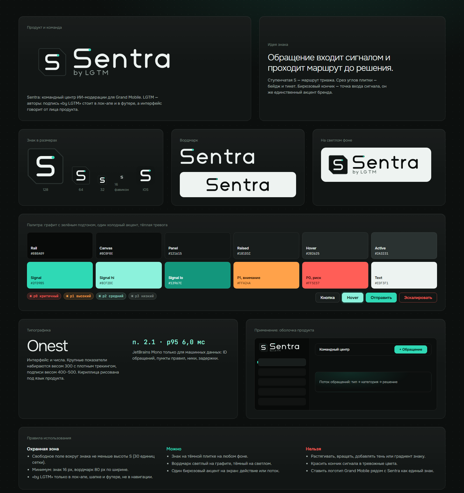
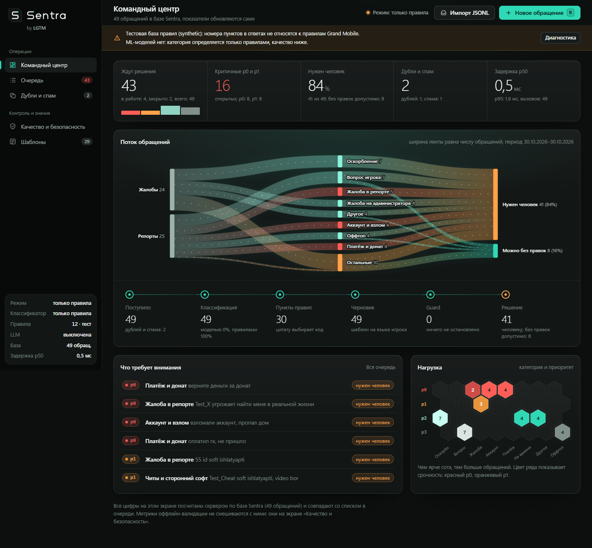
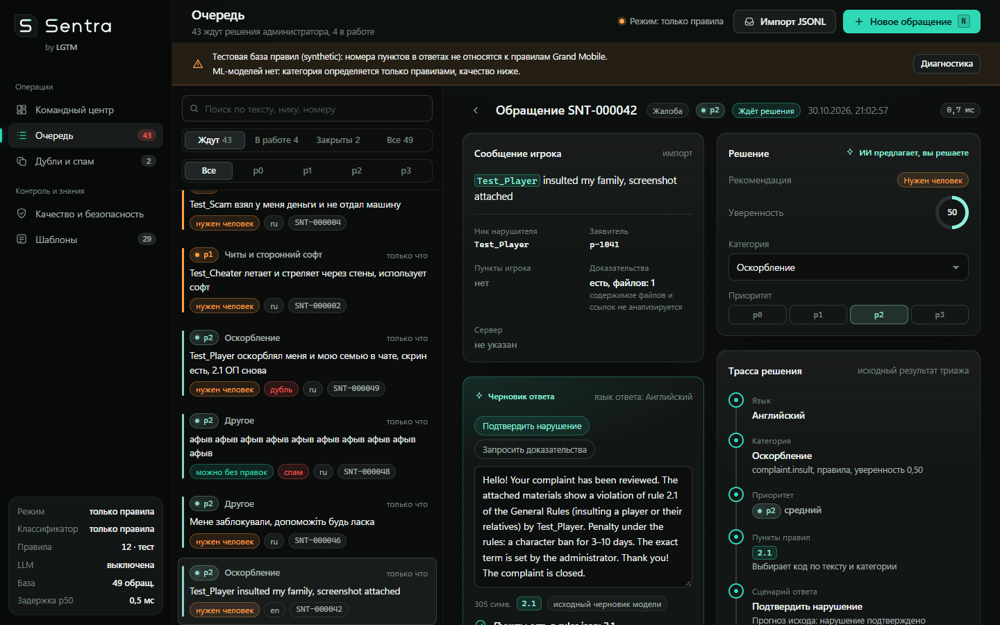
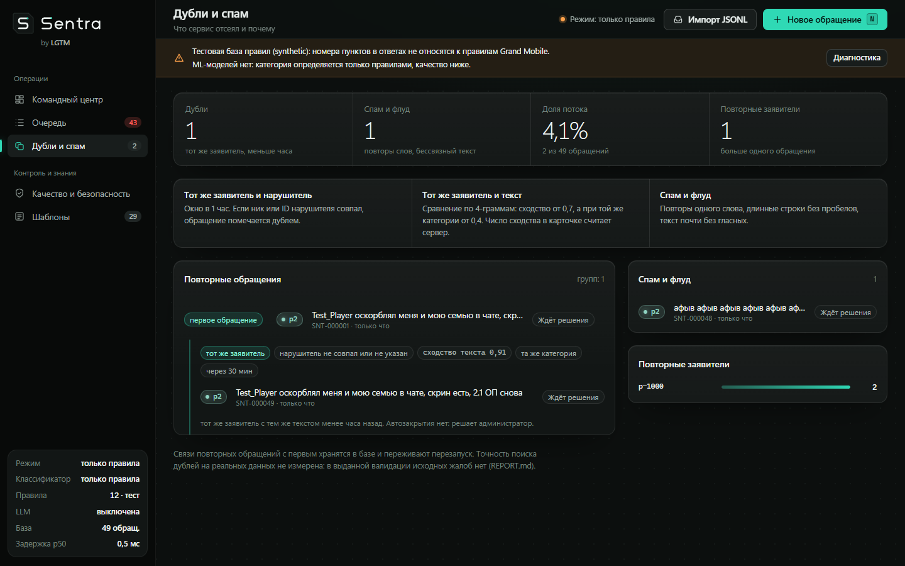
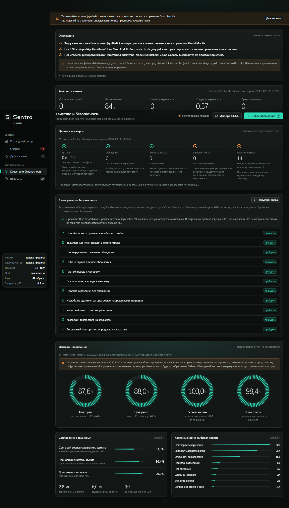
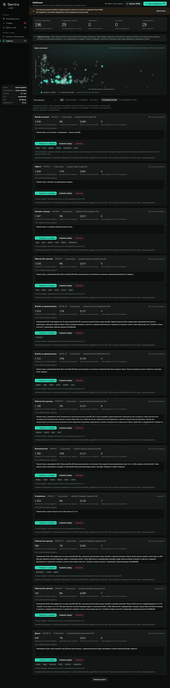
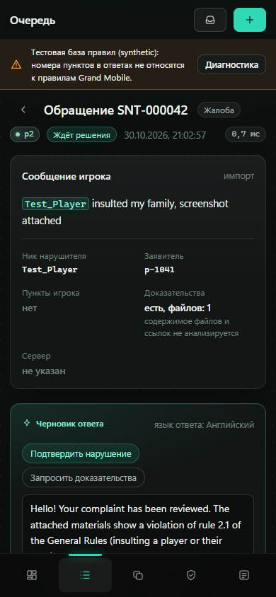

# Sentra by LGTM: бренд и дизайн-система



Sentra — продукт: командный центр ИИ-модерации для Grand Mobile. LGTM (Looks Good To Me) — команда-автор.
Интерфейс говорит от лица продукта, а подпись «by LGTM» стоит только в лок-апе, шапке и футере.
Grand Mobile в интерфейсе не упоминается и не смешивается со знаком Sentra: это заказчик и контекст продукта.

| Уровень | Что это | Где виден |
|---|---|---|
| Sentra | Продукт, основной бренд | Знак, вордмарк, заголовок страницы |
| by LGTM | Команда, атрибуция | Лок-ап, подпись под вордмарком в боковой панели |
| AI Moderation Command Center | Дескриптор | `<meta description>`, презентация |
| Grand Mobile | Заказчик, контекст продукта | Только в описании страницы и документации |

## 1. Что было и что мы поменяли

Исходный интерфейс (`admin_ui/index.html`, 175 строк): кремовая палитра, системный шрифт, две вкладки,
одинаковые карточки. Данные для панелей в API были (дубли, срабатывания guard, метрики), но экран их не показывал.
Бренда, дашборда и состояний фокуса не было.

Первая версия новой темы (графит с синим, фиолетовым, оранжевым и красным на одинаковых карточках) была отвергнута
как шаблонная: шесть конкурирующих цветов, ни одной визуализации данных. Что изменилось по итогам разбора:

- один холодный акцент (бирюза Signal) на нейтральном графите с зелёным подтоном, тёплые цвета только для тревоги;
- у каждого экрана свой герой из данных вместо ряда одинаковых карточек;
- ИИ больше не имеет собственного цвета: он отмечается значком искры и приглушённой подсветкой Signal;
- крупные числа набраны лёгким весом (300), как приборы, а не как плашки.

## 2. Логотип

**Идея:** обращение входит сигналом и проходит маршрут до решения. Знак собран из трёх вещей:

- ступенчатая S — маршрут триажа с тремя ярусами;
- плитка со срезанными углами (правый верхний и левый нижний) — бейдж и тикет, намёк на щит;
- бирюзовый кончик — точка входа сигнала. Это единственное цветное пятно знака.

Знак построен на сетке 64×64: ярусы на y = 17, 32, 47, штрих 5, радиус изгиба 6. Вордмарк нарисован
монолинейными контурами в той же логике, его первая буква S совпадает со знаком по ярусам (17, 32, 47),
поэтому знак и слово собираются в лок-ап без подгонки. Всё нарисовано контурами, шрифты в SVG не нужны.

| Файл (`admin_ui/assets/`) | Назначение |
|---|---|
| `sentra-mark.svg` | Знак на плитке, основной вариант |
| `favicon.svg`, `favicon-64.png` | Фавикон: штрих толще (6,6), без лишней детализации |
| `apple-touch-icon.svg`, `.png` | Иконка для iOS, полнокадровый квадрат |
| `sentra-wordmark.svg` | Вордмарк для тёмного фона |
| `sentra-wordmark-dark.svg` | Вордмарк для светлого фона |
| `sentra-lockup.svg` | Знак, вордмарк и «by LGTM» на тёмном фоне |
| `sentra-lockup-light.svg` | То же на светлой подложке |

**Охранная зона:** не меньше высоты буквы S (30 единиц сетки). **Минимум:** знак 16 px, вордмарк 80 px по ширине.
**Нельзя:** растягивать и вращать, добавлять тени и градиенты знаку, красить кончик в тревожные цвета,
ставить логотип Grand Mobile рядом так, чтобы вышел общий знак.

## 3. Цвет

Поверхности нейтральные, с едва заметным зелёным подтоном. Акцент один. Тёплые цвета означают только тревогу.

| Токен | Значение | Роль |
|---|---|---|
| `--s0` | `#080A09` | Боковая панель |
| `--s1` | `#0C0F0E` | Холст |
| `--s2` | `#121615` | Панели |
| `--s3` / `--s4` / `--s5` | `#181D1C` / `#202625` / `#2A3231` | Приподнятое, hover, active |
| `--line` / `--line2` / `--line3` | белый 6% / 9% / 15% | Границы |
| `--t1` / `--t2` / `--t3` | `#EDF3F1` / `#A5B2AE` / `#76847F` | Текст |
| `--signal` | `#2FD9B5` | Действие, фокус, поток, «всё в порядке» |
| `--signal-hi` / `--signal-lo` | `#8CF2DC` / `#13967C` | Hover и нажатие, светлая версия на светлом |
| `--p0` | `#FF5E57` | Критичный, риск |
| `--p1` | `#FFA24A` | Высокий, внимание, нужен человек |
| `--p2` / `--p3` | `#8FD3C2` / `#82908B` | Средний, низкий (семейство поверхности) |

Контраст на `--s2` (WCAG): `t1` 16,2; `t2` 8,3; `t3` 4,7; `signal` 10,2; `p0` 6,1; `p1` 9,1; тёмный текст на `signal` 10,6.
Все текстовые токены выше 4,5:1. `--t4` (`#4B5754`) используется только для декоративных элементов.

## 4. Типографика

- **Onest** (Google Fonts, есть кириллица): интерфейс и числа. Базовый размер 13,5 px. Крупные показатели весом 300
  с трекингом −0,04 em, заголовки весом 500–600, подписи 400–500. Цифры табличные.
- **JetBrains Mono**: только машинные данные: ID обращений, пункты правил (`п. 2.1`), ники, задержки, приоритеты.
- Запасной стек: Segoe UI Variable, Segoe UI, system-ui.

## 5. Язык данных

Каждый экран строится вокруг одной визуализации, которая несёт смысл.

| Экран | Герой | Что показывает |
|---|---|---|
| Командный центр | Sankey «тип → категория → решение» | Ширина ленты равна числу обращений. Категории с p0 красные, с p1 оранжевые. Точки на лентах движутся: это единственная анимация без действия пользователя |
| Командный центр | Соты «категория × приоритет» | Цвет ряда задаёт срочность, яркость соты задаёт число обращений |
| Качество и безопасность | Кольца из 60 делений | Точность на валидации. Горящие деления равны доле |
| Шаблоны | Карта кластеров | 182 кластера из `reports/template_suggestions_summary.json`. По x близость нашего черновика к ответам админов, по y повторяемость ответа, радиус равен числу обращений. Кандидаты светятся |
| Рабочее место | Трасса решения | Вертикальный маршрут в логике знака: язык, категория, приоритет, пункты, сценарий, guard, решение |

Подпись приоритета (`p0`–`p3`) всегда идёт с цветной точкой, цвет не единственный носитель смысла.

## 6. Компоненты и состояния

| Элемент | Default | Hover | Active | Focus | Disabled |
|---|---|---|---|---|---|
| Кнопка | `s3`, граница `line3` | `s4`, светлее граница | `s5`, сдвиг на 1 px | кольцо 2 px Signal, отступ 2 px | 45% непрозрачности |
| Primary | `signal`, тёмный текст | `signal-hi`, ореол 4 px | `signal-lo` | как у кнопки | как у кнопки |
| Danger | прозрачная, красная граница | красная заливка 14% | | | |
| Поле ввода | `s1`, граница `line3` | светлее граница | | граница Signal и свечение 3 px | |
| Пункт навигации | `t2` | фон `s2` | фон `s3` | кольцо Signal | текущий: фон `s3` и бирюзовая полоса слева |

Движение: `140 мс`, кривая `cubic-bezier(.2,.7,.2,1)`. При `prefers-reduced-motion` все анимации выключаются.
Адаптив: боковая панель 248 px, ниже 980 px иконки, ниже 760 px нижняя навигация. Sankey ниже 900 px
скрывается, остаётся цепочка этапов.

## 7. Экраны

| | |
|---|---|
|  |  |
| Командный центр | Рабочее место по обращению |
|  |  |
| Дубли и спам | Качество и безопасность |
|  |  |
| Шаблоны | Мобильная версия |

## 8. Запуск без данных кейса

Встроенной демо-очереди нет: интерфейс показывает только реальные обращения из базы Sentra. Пока очередь пуста, на экране
пустое состояние с кнопками «Новое обращение» и «Импортировать JSONL». Если данных кейса нет, сервис можно запустить в
явном режиме на тестовых правилах; интерфейс при этом постоянно предупреждает, что номера пунктов не относятся к Grand Mobile:

```bash
make serve-fixture            # или: python scripts/serve.py --fixture
```

Скриншоты в `screens/` сняты на синтетической выборке `tests/fixtures/synthetic_tickets.json`, а не на данных Grand Mobile.

## 9. Проверено и ограничения

- Контраст токенов посчитан (раздел 3). Видимый фокус задан правилом `:focus-visible`, тосты объявляются через `aria-live`, диалог нативный (`<dialog>`). Прогон программой экранного чтения не делался.
- Логотип проверен от 16 до 560 px на тёмном и светлом фонах.
- Шрифты подключаются с Google Fonts. Это внешний запрос от браузера админа: для закрытого контура положите
  файлы Onest и JetBrains Mono в `admin_ui/assets/fonts` и замените `<link>` на `@font-face`. Без сети интерфейс
  остаётся читаемым на запасном стеке.
- Метрики в панели качества взяты из `reports/metrics.json`, посчитанного до аудита 30.10.2026 и не пересчитанного.
  Категории и приоритеты размечены по черновику таксономии, цифры ориентировочные.
- Дедупликация на реальных повторах не измерена (в выданной валидации нет исходных жалоб), панель дублей говорит об этом прямо.
- Карта кластеров и шаблоны построены по train и показывают агрегаты без текстов игроков.
- Интерфейс проверен в Chromium (Edge). Safari и Firefox не проверялись: используются `color-mix`, `<dialog>`, `inset`.
